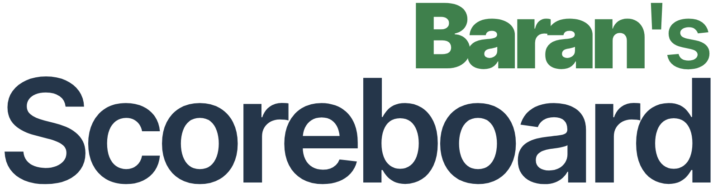

<p align="center">
  <a href="https://scoreboard.baranhq.com"></a>
</p>

# Baran's Scoreboard

Baran's Scoreboard is a free, open-source scoreboard for classroom activities, sports, and friendly competitions. Create teams, keep score, customise colours, and use the timer on a projector or shared screen.

It is **local-first**: no account is needed, and scoreboard names, teams, scores, and settings stay in each browser. Share a snapshot with a link or keep a JSON backup. Links contain the board data in the URL and do not sync later changes.

## What it includes

- Multiple teams, saved scoreboards, custom colours, layouts, and icons.
- Countdown and stopwatch timers, periods, and breaks.
- Fullscreen display with keyboard and touch controls.
- Bulgarian, Turkish, and British English; light, dark, and system themes.
- An optional PHP/MySQL administration backend for the privacy policy and consent-based analytics. Analytics are off by default; game data is never stored in that database.

## Run locally

You need Node.js 24 LTS (or a compatible version at least 22.18) and npm.

```sh
git clone https://github.com/baranhq/scoreboard.git
cd scoreboard
npm ci
npm run dev
```

Open [localhost:3000](http://localhost:3000). This works without PHP or a database.

## Self-hosting

You can run it privately at home, on a home server/NAS, or on a rented Linux server. **You do not need to buy a domain or make the site public.** The guide explains a local-only Docker setup, optional access from your home network, a static-only setup, and shared hosting.

➡️ **[Read the self-hosting guide](SELF_HOSTING.md)**

## Project files

- [Deployment details](docs/DEPLOYMENT.md) · [Backups and recovery](docs/BACKUPS.md) · [Privacy notes](docs/PRIVACY.md)
- [MIT License](LICENSE) · [Third-party licences and notices](LICENSES.md)

Copyright © 2026 Baran Ahmedov. Licensed under the MIT License.
