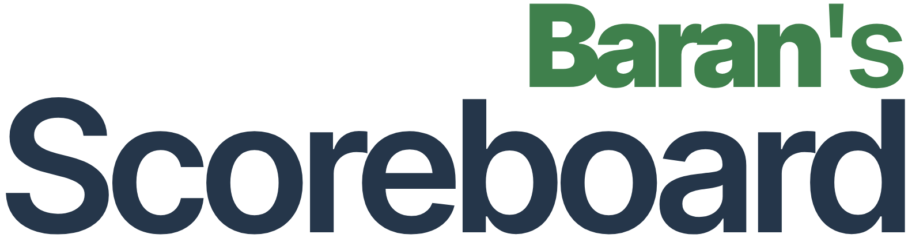

<p align="center">
  <a href="https://scoreboard.baranhq.com"></a>
</p>

# Baran's Scoreboard

Sınıf etkinlikleri, takım oyunları ve dostça yarışmalar için ücretsiz, açık kaynaklı bir çevrim içi skor panosu. Puanları değiştirin, takım adlarını ve renkleri özelleştirin, yerleşik zamanlayıcıyı kullanın ve skorları tam ekranda gösterin. Hesap gerekmez; oyunlar tarayıcınızda saklanır.

[Baran's Scoreboard uygulamasını aç](https://scoreboard.baranhq.com) · [English](README.md) · [Български](README.bg.md) · [Türkçe](README.tr.md)

- Birden fazla takım, otomatik yerel kayıt ve JSON yedekleri.
- Geri sayım, kronometre, maç devreleri ve molalar.
- Sınıf ekranı veya projektör için tam ekran görünüm.
- Türkçe, Bulgarca ve Britanya İngilizcesi arayüz.
- Orijinal kod MIT Lisanslıdır; bağımlılık bildirimleri [LICENSES.md](LICENSES.md) dosyasındadır.

## Başlangıç

Node.js 24 LTS (veya 22.18 ve üzeri uyumlu bir sürüm) ile npm gerekir.

```sh
git clone https://github.com/baranhq/scoreboard.git
cd scoreboard
npm ci
npm run dev
```

[localhost:3000](http://localhost:3000) adresini açın. Oyun verileri bulut hesabına değil, tarayıcının IndexedDB alanına kaydedilir.

## Kendi sunucunuzda barındırma

Paylaşımlı hosting ve cPanel, Docker Compose, PHP/MySQL yönetimi, HTTPS, yedekleme ve güncelleme adımları İngilizce [self-hosting rehberinde](README.md#self-hosting) ve [deployment belgesinde](docs/DEPLOYMENT.md) açıklanır. Kendi alan adınızı ve özel yönetici bilgilerinizi yapılandırın; projede varsayılan yönetici parolası bulunmaz.

[GitHub kaynak kodu](https://github.com/baranhq/scoreboard) · [MIT Lisansı](LICENSE) · [Gizlilik](https://scoreboard.baranhq.com/tr/gizlilik/)
